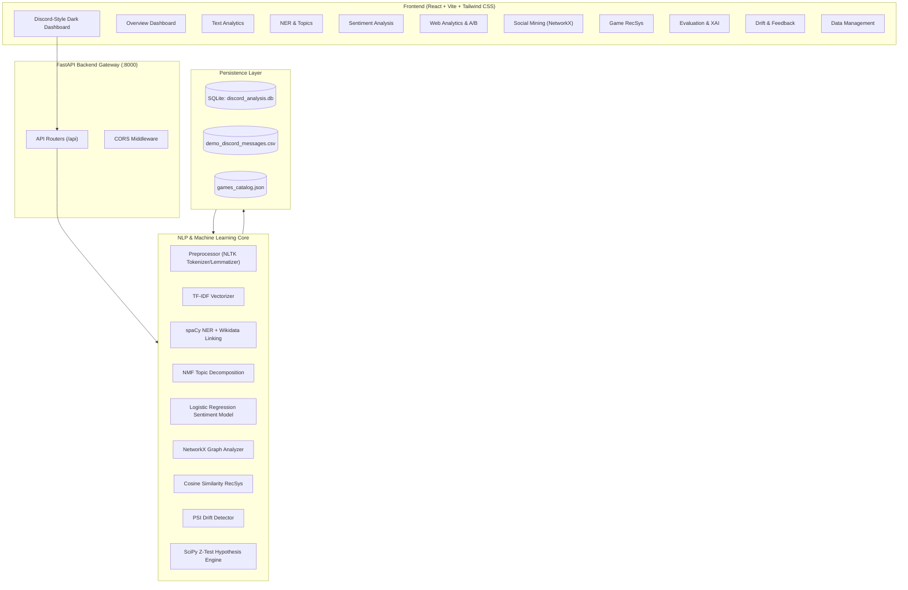

# Discord Text Web Analysis — Full-Stack AI Platform

> **Final-Year Computer Engineering Capstone Project**  
> An interactive web application integrating **Text Analytics**, **Web Analytics**, **Social Media Mining**, **Sentiment Analysis**, and **Recommendation Systems** to discover community insights, influential participants, and personalized game recommendations from Discord conversational text.

---

## 1. Project Overview & Objectives

In modern online gaming and developer communities, Discord servers host thousands of unstructured text conversations daily. Understanding community trends, prevailing sentiment, user influence, and topic shifts is crucial for community managers, game developers, and researchers.

**Discord Text Web Analysis** converts raw, noisy Discord conversations into actionable intelligence through:
* **Text Analytics & NLP Preprocessing:** Tokenization, normalization (regex stripping of URLs, `@mentions`, `#channels`, emojis), stopword filtering, WordNet lemmatization, Porter stemming, and TF-IDF feature weighting.
* **Named Entity Recognition (NER) & Linking:** Identifies entities (PERSON, ORG, GPE, GAME) via spaCy and domain Gazetteers, resolved to canonical **Wikidata Knowledge Base** entities.
* **Topic Discovery:** Unsupervised **Non-negative Matrix Factorization (NMF)** on TF-IDF vectors, tracking temporal topic trends across weeks.
* **Sentiment Classification:** Supervised Logistic Regression with sublinear TF-IDF features and class balancing, evaluated strictly on held-out test data (25% split) with confusion matrix and classification reports.
* **Social Media Mining:** Models user reply-to and `@mention` interactions as a directed graph using **NetworkX**, computing Degree Centrality, Betweenness Centrality, PageRank, and Greedy Modularity communities.
* **Personalized Game Recommendations:** Hybrid Content-Based Filtering using TF-IDF cosine similarity across catalog metadata, augmented by live Discord community sentiment signals.
* **Web Analytics & A/B Testing:** Educational HTML metadata architecture paired with an algorithmic A/B testing simulator computing two-sample proportion Z-tests, $P$-values, and 95% Confidence Intervals.
* **MLOps & Drift Monitoring:** Tracks longitudinal distribution shifts using the **Population Stability Index (PSI)**, flags emerging vocabulary, and stores human-in-the-loop prediction corrections into SQLite.

---

## 2. Technology Stack

| Layer | Technologies |
| :--- | :--- |
| **Frontend** | React 18, Vite 5, Tailwind CSS, Recharts, Lucide React |
| **Backend** | Python 3.10+, FastAPI, Uvicorn, Pydantic v2 |
| **NLP & ML** | Scikit-learn, spaCy (`en_core_web_sm`), NLTK, SciPy, NumPy, Pandas |
| **Network Analysis** | NetworkX (Graph theory, Centrality metrics, Community detection) |
| **Database** | SQLite, SQLAlchemy 2.0 ORM |
| **Testing** | Pytest, FastAPI TestClient, HTTPX |

---

## 3. System Architecture



---

## 4. Syllabus Topic to Project Implementation Mapping

| University Syllabus Area | Implemented Module & Source Code | Practical Engineering Feature |
| :--- | :--- | :--- |
| **1. Text Analytics & Preprocessing** | [`backend/app/nlp/preprocessor.py`](file:///C:/Users/kpgam/.gemini/antigravity/scratch/discord-text-web-analysis/backend/app/nlp/preprocessor.py)<br>[`backend/app/nlp/vectorizer.py`](file:///C:/Users/kpgam/.gemini/antigravity/scratch/discord-text-web-analysis/backend/app/nlp/vectorizer.py) | Tokenization, noise normalization, WordNet lemmatizer, Porter stemmer, gaming slang dictionary, TF-IDF feature weights. |
| **2. Information Extraction & NER** | [`backend/app/nlp/entities.py`](file:///C:/Users/kpgam/.gemini/antigravity/scratch/discord-text-web-analysis/backend/app/nlp/entities.py) | spaCy Named Entity Recognition for PERSON, ORG, GPE, and GAME; Wikidata knowledge graph entity linking with QIDs. |
| **3. Topic Modeling** | [`backend/app/nlp/topics.py`](file:///C:/Users/kpgam/.gemini/antigravity/scratch/discord-text-web-analysis/backend/app/nlp/topics.py) | Unsupervised NMF matrix factorization extracting semantic topic clusters and tracking weekly temporal popularity trends. |
| **4. Sentiment Analysis** | [`backend/app/ml/sentiment_model.py`](file:///C:/Users/kpgam/.gemini/antigravity/scratch/discord-text-web-analysis/backend/app/ml/sentiment_model.py) | Multiclass Positive/Neutral/Negative classification with confidence scores, held-out test evaluation, confusion matrix. |
| **5. Social Media Mining** | [`backend/app/social_network/network_analyzer.py`](file:///C:/Users/kpgam/.gemini/antigravity/scratch/discord-text-web-analysis/backend/app/social_network/network_analyzer.py) | NetworkX graph from replies & mentions; Degree Centrality, Betweenness Centrality, PageRank, Greedy Modularity communities. |
| **6. Recommendation Systems** | [`backend/app/ml/recommender.py`](file:///C:/Users/kpgam/.gemini/antigravity/scratch/discord-text-web-analysis/backend/app/ml/recommender.py) | Hybrid Content-Based Filtering using TF-IDF cosine similarity, genre overlap bonus, and live Discord sentiment boost. |
| **7. Web Analytics & Testing** | [`backend/app/web_analytics/ab_testing.py`](file:///C:/Users/kpgam/.gemini/antigravity/scratch/discord-text-web-analysis/backend/app/web_analytics/ab_testing.py) | HTML metadata architecture documentation, event telemetry, two-sample Z-test simulation with $P$-values and 95% CIs. |
| **8. Model Evaluation & XAI** | [`backend/app/ml/explainability.py`](file:///C:/Users/kpgam/.gemini/antigravity/scratch/discord-text-web-analysis/backend/app/ml/explainability.py) | Glass-box linear coefficients for global importance, local token attribution, demographic/channel slice bias evaluation. |
| **9. MLOps & Drift Monitoring** | [`backend/app/ml/drift_detector.py`](file:///C:/Users/kpgam/.gemini/antigravity/scratch/discord-text-web-analysis/backend/app/ml/drift_detector.py) | Population Stability Index (PSI) drift calculation, emerging vocabulary detection, SQLite human feedback collection queue. |

---

## 5. Step-by-Step Installation & Execution Guide

### Prerequisites
* **Python 3.10+** (Tested on Python 3.10, 3.11, 3.12, 3.14)
* **Node.js 18+** & npm (Tested on Node v22)
* **Git** (optional)

### Step 1: Open Terminal in Project Root
```cmd
cd C:\Users\kpgam\.gemini\antigravity\scratch\discord-text-web-analysis
```

### Step 2: Set Up Python Virtual Environment
```cmd
cd backend
python -m venv venv
call venv\Scripts\activate
python -m pip install --upgrade pip
pip install -r requirements.txt
```

### Step 3: Configure Environment Variables
Copy the template `.env.example` to `.env`:
```cmd
copy .env.example .env
```
*(The system runs 100% in **Mode A (Demo Mode)** without Discord credentials. Setting `DISCORD_BOT_TOKEN` is strictly optional for Mode B).*

### Step 4: Run the Backend Server
```cmd
python -m uvicorn app.main:app --host 127.0.0.1 --port 8000 --reload
```
* Backend API: `http://127.0.0.1:8000`
* Swagger Interactive API Docs: `http://127.0.0.1:8000/docs`

### Step 5: Start the React Frontend
In a new terminal window:
```cmd
cd C:\Users\kpgam\.gemini\antigravity\scratch\discord-text-web-analysis\frontend
npm run dev
```
* Dashboard URL: `http://localhost:5173`

---

## 6. One-Click Startup (Windows Batch Files)

We provide pre-configured Windows batch scripts in the project root:
* **`run_all.bat`**: Launches both the FastAPI backend and React frontend concurrently in two dedicated command windows.
* **`run_backend.bat`**: Starts only the FastAPI server on port 8000.
* **`run_frontend.bat`**: Starts only the Vite frontend dev server on port 5173.

---

## 7. Running Automated Tests

A comprehensive Pytest test suite with 18 automated unit and integration tests is included.

To execute the test suite:
```cmd
cd backend
python -m pytest tests/ -v
```

Expected test results:
```text
tests/test_api.py::test_health_endpoint PASSED                           [  5%]
tests/test_api.py::test_dashboard_endpoint PASSED                        [ 11%]
tests/test_api.py::test_topics_endpoint PASSED                           [ 16%]
tests/test_api.py::test_entities_endpoint PASSED                         [ 22%]
tests/test_api.py::test_network_endpoint PASSED                          [ 27%]
tests/test_api.py::test_recommend_endpoint PASSED                        [ 33%]
tests/test_api.py::test_model_metrics_endpoint PASSED                    [ 38%]
tests/test_api.py::test_sentiment_predict_endpoint PASSED                [ 44%]
tests/test_api.py::test_drift_endpoint PASSED                            [ 50%]
tests/test_network.py::test_social_network_graph PASSED                  [ 55%]
tests/test_nlp.py::test_text_cleaning PASSED                             [ 61%]
tests/test_nlp.py::test_tokenization_and_lemmatization PASSED            [ 66%]
tests/test_nlp.py::test_gaming_slang_detection PASSED                    [ 72%]
tests/test_tfidf_term_extraction PASSED                                 [ 77%]
tests/test_recommender.py::test_catalog_loaded PASSED                    [ 83%]
tests/test_recommender.py::test_game_recommendations PASSED              [ 88%]
tests/test_sentiment.py::test_model_training_and_metrics PASSED          [ 94%]
tests/test_sentiment.py::test_sentiment_prediction PASSED                [100%]
======================== 18 passed in 7.55s ========================
```

---

## 8. REST API Endpoints Reference

| Method | Endpoint | Description |
| :--- | :--- | :--- |
| `GET` | `/api/health` | Health check verifying API status and database records. |
| `GET` | `/api/dashboard` | Dynamically calculated overview dashboard metrics and trends. |
| `POST` | `/api/nlp/process-text` | Executes complete step-by-step NLP preprocessing on input text. |
| `GET` | `/api/nlp/term-frequencies` | Computes word frequencies and top TF-IDF term weights. |
| `GET` | `/api/topics` | Extracts NMF topic clusters and weekly trends. |
| `GET` | `/api/entities` | Returns spaCy recognized entities with Wikidata QIDs. |
| `POST` | `/api/sentiment/predict` | Predicts sentiment with confidence, probabilities, and slang tokens. |
| `GET` | `/api/sentiment/distribution`| Multidimensional breakdown of sentiment by game, channel, and date. |
| `GET` | `/api/network` | NetworkX graph nodes, edges, centrality metrics, and clusters. |
| `POST` | `/api/recommend` | Personalized game recommendations with matching reasons. |
| `GET` | `/api/recommend/genres` | Unique list of game genres from the curated catalog. |
| `GET` | `/api/web-analytics/overview`| HTML metadata syllabus guide and dataset engagement telemetry. |
| `POST` | `/api/web-analytics/ab-test` | Simulates two-sample proportion Z-test hypothesis testing. |
| `GET` | `/api/model/metrics` | Held-out test evaluation report, confusion matrix, and bias diagnostics. |
| `POST` | `/api/model/explain` | Computes local feature attribution (XAI) for a prediction. |
| `GET` | `/api/drift` | Compares baseline vs recent periods using Population Stability Index. |
| `POST` | `/api/feedback` | Saves user-corrected prediction into SQLite feedback registry. |
| `GET` | `/api/feedback/list` | Retrieves stored feedback records. |
| `GET` | `/api/data/preview` | Paginated preview of active messages stored in SQLite. |
| `POST` | `/api/data/upload` | Validates and ingests user-uploaded CSV dataset. |
| `GET` | `/api/data/download` | Exports active analyzed dataset as downloadable CSV. |
| `POST` | `/api/data/reset-demo` | Resets SQLite database to original 200 demo records. |

---

## 9. Data Ethics & Responsible AI Implementation

1. **Consent & Authorized Collection:** Mode A operates entirely offline on synthetic demo datasets. Mode B requires explicit server administrator authorization via official Discord Bot OAuth2 intents (`Read Message History` & `View Channels`). Direct Messages (DMs) are strictly prohibited.
2. **Data Minimization & User Pseudonymization:** All raw Discord snowflakes and personal handles are hashed into pseudonymous identifiers (e.g. `user_shadow_99`) prior to storage.
3. **Model Limitations & Bias:** Sentiment models are limited by gamer sarcasm, evolving abbreviations, and short text. The system explicitly quantifies performance across channel, length, and slang slices.
4. **Transparent Explainability:** Every prediction exposes local token attribution weights. Every game recommendation explains why the title was recommended.

---

## 10. Student Viva Voce Defense Guide (Frequently Asked Questions)

### Q1: Why did you use TF-IDF + Logistic Regression rather than a large Transformer like BERT?
> **Answer:** For an interactive production-grade engineering capstone, Logistic Regression with TF-IDF provides sub-millisecond inference latency, zero GPU dependencies, and complete mathematical transparency. We can inspect the exact linear model weights ($w_i$) to explain every prediction without black-box opacity.

### Q2: How is the Population Stability Index (PSI) calculated for Data Drift?
> **Answer:** $\text{PSI} = \sum \left( \text{Actual}\% - \text{Expected}\% \right) \times \ln\left( \frac{\text{Actual}\%}{\text{Expected}\%} \right)$. A value $< 0.1$ indicates negligible shift, $0.1 \le \text{PSI} < 0.25$ indicates moderate drift, and $\ge 0.25$ indicates significant drift requiring model audit.

### Q3: How do Degree Centrality and Betweenness Centrality differ in Social Mining?
> **Answer:** Degree Centrality counts the direct connections of a node ($C_D(v) = \text{deg}(v) / (N-1)$), measuring active discussion participation. Betweenness Centrality ($C_B(v) = \sum_{s \neq v \neq t} \frac{\sigma_{st}(v)}{\sigma_{st}}$) measures how often a node falls on the shortest path between other participants, identifying gatekeepers or informational bridges between different gaming cliques.

### Q4: How are game recommendations computed?
> **Answer:** The engine builds TF-IDF vectors of game descriptions and tags. It computes the Cosine Similarity with the user preference query, then adds a genre overlap bonus (+0.15) and a community sentiment bonus (+0.08 if positive, -0.05 if negative).
